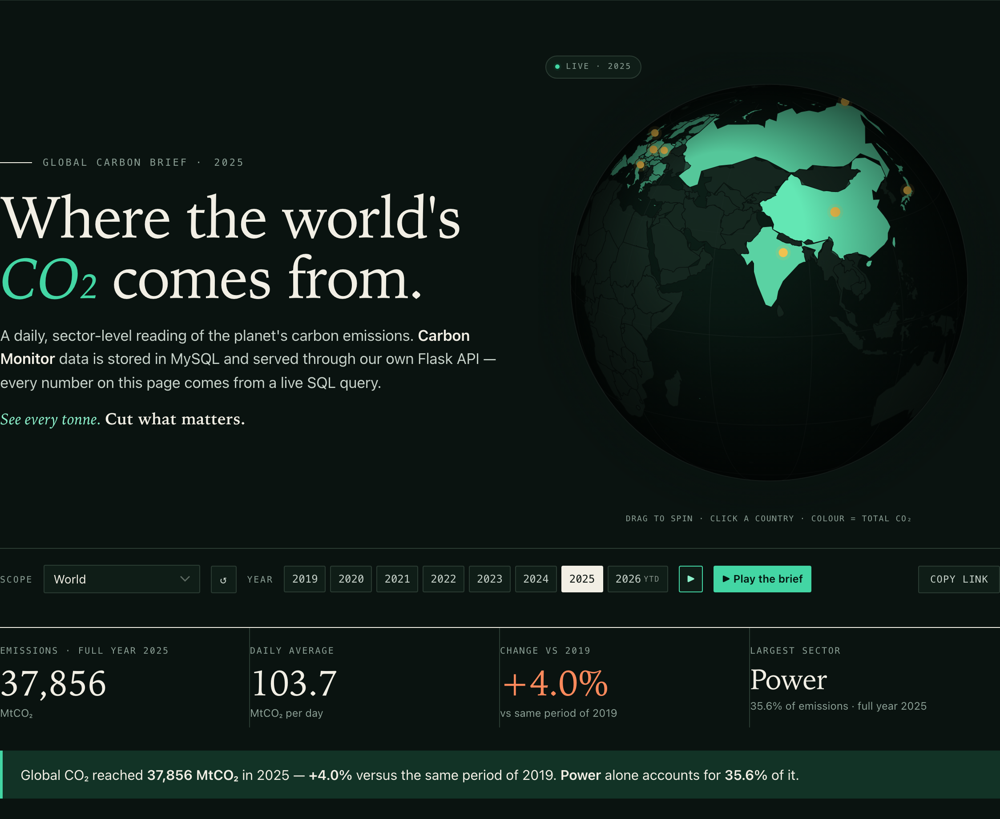
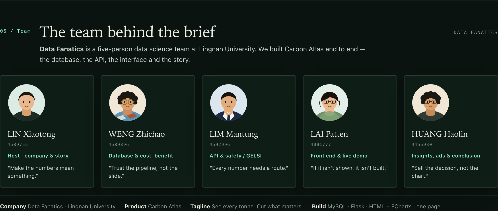
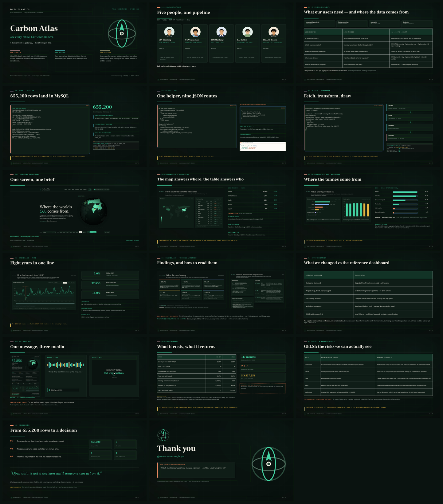
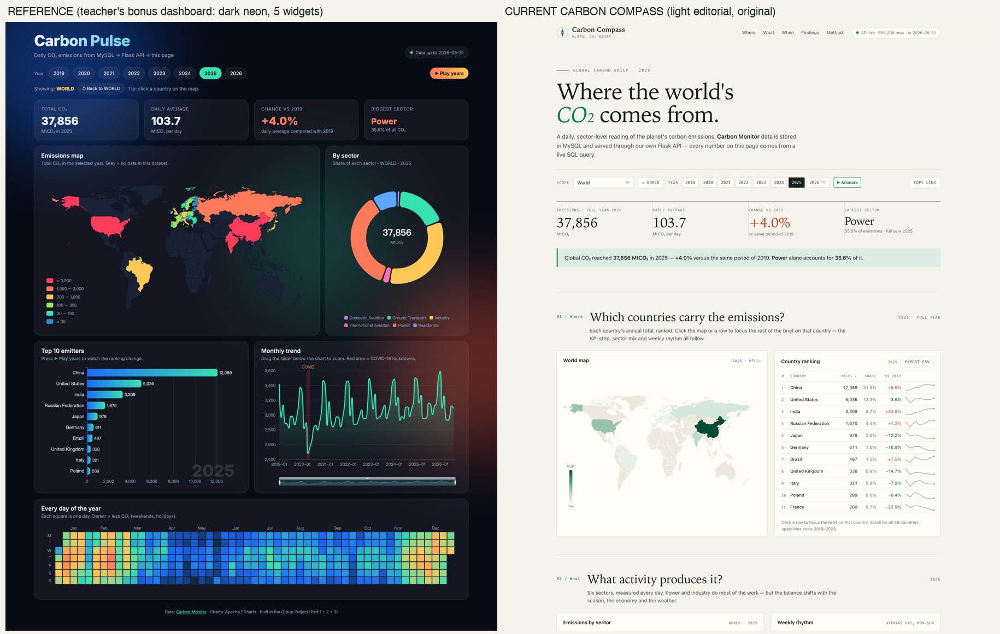

# Carbon Atlas · CDS3001 Group Project

**公司 / Company：Data Fanatics** · **产品 / Product：Carbon Atlas** · **Tagline：See every tonne. Cut what matters.**
Lingnan University · CDS3001 Databases and Data Warehouses · 2026-11-27 18:00 HKT 提交

**GitHub repo（public）**：<https://github.com/AaaaaronLIN/carbon-atlas-cds3001>

> 这是给组员看的**项目主页**：所有交付物、当前进度、剩余任务、演示怎么用都在这里。新组员请从本页开始。

---

## 0. 一页速览（2026-11-19 更新）

| 项目 | 状态 |
|---|---|
| 数据库（Part 1） | ✅ 655,200 行已导入 MySQL，`LOAD DATA` + 验证输出齐全 |
| API（Part 2） | ✅ Flask 9 条 JSON 路由，本机实测全部 200 |
| 网页（Part 3） | ✅ Carbon Atlas 2.0，Stage 默认主题；`http://127.0.0.1:5001/` |
| 最终前端 PDF | ✅ 10 页（必交） |
| 17 页 PPT | ✅ 已内嵌 90 秒 demo 视频 + 30 秒音频 + 45 秒视频广告 |
| 海报 / 音频 / 视频广告 | ✅ 海报 2.0、30 s 音频草稿、45 s 视频草稿 |
| 9:23 讲稿 / Q&A | ✅ 完整 run-of-show + 5 人逐字稿 + Q&A + 主持 cue card |
| 成本效益 / GELSI | ✅ xlsx + deck S14/S15 + 网页 Method 面板 |
| **还差** | 🟡 **Patten 真人声**、Windows PowerPoint 试播、Workbench 截图、全组排练、Moodle 提交 |

---

## 0.5 先看这几张（组员快速了解）

| Stage 主题首页（默认） | 团队区 |
|---|---|
|  |  |

| 17 页 deck 总览（S7 demo / S13 广告） | 讲师参考版 vs 我们的版本 |
|---|---|
|  |  |

> 更多截图在 `assets/screenshots/`；deck 内嵌媒体说明见 `deliverable/` 与 `presentation/scripts/00_run_of_show.zh.md`。
> **GitHub 仓库地址 / 日常操作（clone、push、邀请组员）**：见 [`docs/PUBLISH_TO_GITHUB.md`](docs/PUBLISH_TO_GITHUB.md)。
> 最终 Moodle 提交 ZIP 不在 repo 里（体积原因）；repo 的 `code/` + `deliverable/` 已包含全部必交文件，ZIP 由 Lead 另外打包发群。

---

## 1. 团队与分工

| 姓名 | 学号 | 角色 | 台上负责（口述秒数） |
|---|---|---|---|
| **LIN Xiaotong** | 4589755 | **Host · company & story** | 公司介绍/用户需求/全部转场/Q&A 主持（109 s） |
| WENG Zhichao | 4589896 | Database & cost–benefit | Part 1 code（42 s）+ 成本效益（50 s） |
| LIM Mantung | 4592996 | API & safety / GELSI | Part 2 code（42 s）+ 安全与责任（53 s） |
| LAI Patten | 4001777 | Front end & demo | Part 3 code（42 s）+ demo A 录制旁白（47 s）+ **广告人声** |
| HUANG Haolin | 4455930 | Insights, ads & conclusion | demo B（53 s）+ 广告（5 s + 75 s 媒体）+ 结论（40 s） |

> 总长 **563 s = 9:23** + 1 分钟 Q&A；每人实际说话 92–109 s。完整版：[`presentation/scripts/00_run_of_show.zh.md`](presentation/scripts/00_run_of_show.zh.md)

---

## 2. 项目是什么（一句话）

Carbon Monitor 的**每日碳排放 CSV** → **MySQL** → **Flask JSON API** → **Carbon Atlas 网页**（地球/地图/排名表/部门/趋势/对比/Findings/GELSI），最后用 9:23 英文无笔记演示讲成一个给客户的产品方案。

**数据口径（所有物料统一）**：655,200 行 · 39 个 country/region series · 6 个部门 · 2019-01-01 → 2026-08-31 · 单位 MtCO₂/day；2025 世界 37,856 MtCO₂（+4.0% vs 2019）；2026 只有 1–8 月，所有比较为 **like-for-like**。

---

## 3. 怎么用这套东西（组员最关心的）

### 3.1 看 PPT（GitHub 不能预览 `.pptx`，正常）
- **在线翻页看**（推荐）：[`deliverable/Carbon_Atlas_Deck.pdf`](deliverable/Carbon_Atlas_Deck.pdf) — GitHub 直接显示 PDF
- **可编辑原文件**：[`deliverable/Carbon_Atlas_Deck.pptx`](deliverable/Carbon_Atlas_Deck.pptx) — 点 **Download**，PowerPoint 打开；GitHub 只会显示 "View raw"，不会渲染页面
- **17 页总览图**：[`assets/screenshots/deck-contact-final.png`](assets/screenshots/deck-contact-final.png)
- 文件说明汇总：[`deliverable/README.md`](deliverable/README.md)
- **F5 放映** → **S7** 点深色画面播放 **90 秒 demo** → **S13** 点 `PLAY 30 s AUDIO`、`PLAY 45 s AD`
- 教室 Windows 电脑**务必提前试播**；如果内嵌媒体不播，用 U 盘里 `presentation/ads/audio`、`presentation/ads/video` 的独立文件直接播放
- 逐页讲稿：[`presentation/scripts/`](presentation/scripts/)（PPT-only 版，媒体播放 cue 已写好）

### 3.2 看网页（自己电脑，需 MySQL）
```bash
cd code
python3 -m pip install -r requirements.txt
# 先在 MySQL 里跑 code/Part_1_setup.sql 导入数据
export DB_PASSWORD='你的MySQL密码'
python3 app.py
# 打开 http://127.0.0.1:5001/
```
默认是 **Stage 深色主题**；`?theme=light` 是打印/评审用的浅色。

### 3.3 看最终前端 PDF（必交）
[`deliverable/Carbon_Atlas_Final_Frontend.pdf`](deliverable/Carbon_Atlas_Final_Frontend.pdf)（10 页）

### 3.4 看广告三媒体
- 海报：[`deliverable/poster.png`](deliverable/poster.png) / `.pdf`
- 30 s 音频草稿：[`deliverable/audio_ad_30s_draft.mp3`](deliverable/audio_ad_30s_draft.mp3)
- 45 s 视频草稿：[`deliverable/carbon_atlas_ad_45s.mp4`](deliverable/carbon_atlas_ad_45s.mp4)
- **Patten 录音指南**：[`presentation/ads/voice_recording_sheet_Patten.md`](presentation/ads/voice_recording_sheet_Patten.md)

### 3.5 每个人要背的稿子（打印版）
- **A4 可打印 PDF（10 页）**：[`presentation/Team_Rehearsal_Handout.pdf`](presentation/Team_Rehearsal_Handout.pdf)
  - p1 团队/幻灯片分工；p2 时间线/舞台规则/时间纪律；p3 LIN；p4 LIN 互动+Q&A；p5 WENG；p6 LIM；p7 LAI；p8–9 HUANG；p10 Q&A/final check/rubric
- **每人单独 PDF（可直接发人）**：[`presentation/Team_Handouts_Individual.zip`](presentation/Team_Handouts_Individual.zip)

### 3.6 现场 live 网站演示（已决定：S7 优先 live，录屏 fallback）
- 完整手册（TA 版，含 tunnel / 热点 / 90 秒操作 / 失败处理）：[`presentation/LIVE_DEMO_PLAYBOOK.zh.md`](presentation/LIVE_DEMO_PLAYBOOK.zh.md)
- 操作卡（LAI 打印一张）：[`presentation/LIVE_DEMO_OPERATOR_CARD.md`](presentation/LIVE_DEMO_OPERATOR_CARD.md)
- Mac 一键起 Flask：`DB_PASSWORD='...' tools/start_live_demo.sh`
- 公网 HTTPS URL：`tools/start_tunnel.sh`（Cloudflare quick tunnel，今天已实测 `/api/health` 200）
- 预检：`python3 tools/live_demo_check.py https://xxxx.trycloudflare.com`
- 失败 5 秒内切回 S7 的 90 秒录屏（已内嵌，U 盘也有独立 mp4）；讲稿 `presentation/scripts/` 已改为 live 版。

**一句话**：Mac 跑 MySQL + Flask → `cloudflared` 给一个 `https://...trycloudflare.com` → 教室 Windows 浏览器打开；如果教室网络挡，切回 S7 录屏。

---

## 4. 演示结构（9:23）

| # | 环节 | 秒 | 讲者 |
|---|---|---|---|
| 1 | 公司介绍 + logo + 成员 + 卡通头像（含开场举手 poll） | 50 | LIN |
| 2 | User Requirements（含"猜 2025 vs 2019"） | 38 | LIN |
| 3 | Part 1 code | 42 | WENG |
| 4 | Part 2 code | 42 | LIM |
| 5 | Part 3 code | 42 | LAI |
| 6a | 播 S7 90 s demo + 地球/地图/排名表旁白（含 India vs Russia 举手竞猜） | 58 | LAI + LIN |
| 6b | demo 后半段 + Findings/GELSI 旁白 → S12 | 53 | HUANG |
| 7 | 广告：海报 → 30 s 音频 → 45 s 视频 | 80 | HUANG |
| 8 | Cost–Benefit | 50 | WENG |
| 9 | Safety & Responsibility（GELSI） | 53 | LIM |
| 10 | Conclusion | 40 | HUANG |
| — | Host 收尾 + Q&A（含问别组问题） | 5 + 60 | LIN |

3 个互动：**开场举手**、**猜 2025 vs 2019**、**India vs Russia 2025 谁多**（答案 India 3,309 / Russia 1,670）。

---

## 5. 剩余任务（组员必看）

| # | 任务 | 负责人 | 期限 | 说明 |
|---|---|---|---|---|
| 1 | 录 30 s + 45 s 人声 | **LAI Patten** | **11-24** | 按 voice sheet 录，发文件给 Lead；Lead 替换后重新嵌 PPT/ZIP |
| 2 | Windows PowerPoint 试播（播 S7/S13 媒体、全屏、声音） | 全组 | **11-24/25** | 最关键未知数；U 盘准备独立媒体文件 |
| 3 | Workbench 截图（`carbon_lab.carbon_emission`, 655,200 行） | 全组 | 11-24 | Part 1 证据 + 现场展示 |
| 4 | 全组排练 9:23 两次（无笔记、每人发言、媒体 cue） | 全组 | **11-25/26** | 手机录像发 Lead 挑问题 |
| 5 | 提交 ZIP 到 Moodle 并确认 | 全组 | **11-26 晚 / 最迟 11-27 18:00** | 一个月一个 ZIP；见 `docs/SUBMISSION_README.md` |

> 照片（可选）：有 5 张正脸照可以换成更像本人的卡通头像；不给就用现在的原创卡通头像（已满足 rubric）。

---

## 6. 关键决定（避免反复改）

1. **公司 = Data Fanatics；产品 = Carbon Atlas；tagline = See every tonne. Cut what matters.**
2. **默认 Stage 深色主题**（投影好看、更高级）；Day 浅色留给 PDF/打印。
3. **现场按 "只放 PPT" 设计**：demo 是 90 秒真实录屏（不是现场跑 MySQL）；讲稿诚实写 "recording of the live build"。
4. **数据冻结在 2026-08-31 快照**，所有物料数字一致；不要重新下载 CSV 改数字。
5. **广告三媒体同一句 campaign line**：`37,856 million tonnes a year. Now find the part you can move.`
6. **网页不是讲师 bonus dashboard 的换皮**：新品牌、新布局、地球/Stage/Story/团队区/对比/Index/GELSI/离线资产；对比见 `assets/screenshots/comparison-current.png`。

---

## 7. 目录说明

```
carbon-atlas-cds3001/
├─ README.md                  ← 本页（组员入口）
├─ code/                      ← Part 1/2/3 可运行代码 + API 文档
├─ deliverable/               ← 必交/演示用成品：PPT、PPT PDF、最终前端 PDF、海报、demo/广告视频、音频
├─ docs/                      ← 要求指南、合规矩阵、QA、提交说明、状态、决定、TODO
│  ├─ 01_requirements_and_submission_guide.zh.md / .docx
│  ├─ COMPLIANCE_MATRIX.md
│  ├─ FINAL_QA_CHECKLIST.md
│  ├─ SUBMISSION_README.md
│  ├─ 00_STATUS.md · 01_DECISIONS.md · 02_TODO_OWNERS.md · CHANGELOG.md
│  └─ PUBLISH_TO_GITHUB.md
├─ presentation/              ← 讲稿、run-of-show、广告脚本、成本 xlsx
│  ├─ Team_Rehearsal_Handout.pdf ← 10 页 A4 打印稿（每人一页 + 时间线 + 互动 + Q&A）
│  ├─ Team_Handouts_Individual.zip ← 5 人各自 PDF
│  ├─ scripts/                ← 9 份讲稿（host/5 人/Q&A/cue card/interaction）
│  └─ ads/                    ← 海报源文件、音频/视频脚本、Patten 录音稿、媒体文件
├─ assets/screenshots/        ← 关键截图（Stage hero、团队页、17 页 deck 总览、广告页等）
├─ tools/                     ← 生成 PDF / 录制 demo 用的脚本（可复现）
└─ .gitignore
```

---

## 8. 提交要求（Lecture 17）

- **2026-11-27 (周五) 18:00 HKT**，Moodle 交**一个 ZIP**；
- ZIP 内需有：**Part 1 code + Part 2 code + Part 3 code + 最终前端 PDF**（本 repo 的 `code/` + `deliverable/Carbon_Atlas_Final_Frontend.pdf` 已满足）；
- 不延期、迟交按日扣分；解压检查、确认 Moodle 显示提交成功。
- 详细版：[`docs/SUBMISSION_README.md`](docs/SUBMISSION_README.md)

---

## 9. 目前已知风险 / fallback

| 风险 | 应对 |
|---|---|
| 教室 Windows 播不了内嵌媒体 | U 盘独立 mp4/mp3 直接播；S8–S11 截图仍在 deck 里；讲稿有媒体失败话术 |
| 无法现场跑 MySQL/Python | 已录 90 s demo 视频，PPT-only 设计 |
| 排练超时 | `presentation/scripts/00_run_of_show.zh.md` 有 8:38 / 9:18 检查点与删句机制 |
| Patten 11-24 前没录 | 当前 TTS 草稿已嵌入，可先交；但真人声更好 |
| 数据被重新下载导致数字变化 | 冻结 2026-08-31 快照，不改 |

---

## 10. 变更记录

- **v1.0**：Carbon Compass 初版（浅色、讲师 bonus 参考）
- **v2.0**：Carbon Atlas 品牌 + Stage 主题 + 地球 + Story + 团队区 + 真实成员/头像
- **v3.0**：9:23 PPT-only 讲稿、90 s demo 录屏、30 s 音频 + 45 s 视频广告、媒体嵌入、10 页前端 PDF、最终 ZIP
- 详细：`docs/CHANGELOG.md`
