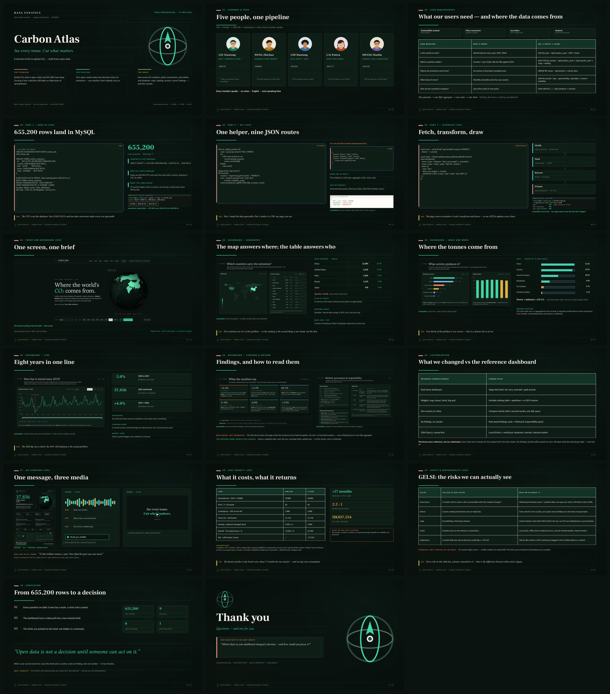

# 交付物怎么打开（Deck / PDF / 海报 / 媒体）

> ⚠️ **GitHub 不能在线预览 `.pptx`**：点 `.pptx` 只会看到 "View raw / Download"，这是正常的。
> 想在浏览器里翻页看，请点 **`Carbon_Atlas_Deck.pdf`**；想看/改原文件，下载 `.pptx` 用 PowerPoint 打开。

| 文件 | 用途 | 怎么打开 |
|---|---|---|
| `Carbon_Atlas_Deck.pdf` | 17 页 deck 的 PDF 预览 | **GitHub 直接点开就能翻页** |
| `Carbon_Atlas_Deck.pptx` | 可编辑 deck（媒体已内嵌） | 下载后用 PowerPoint 打开，F5 放映 |
| `Carbon_Atlas_Final_Frontend.pdf` | 必交最终前端 PDF（10 页） | GitHub 可直接预览 |
| `poster.png` / `poster.pdf` | A3 海报（Stage 深色版） | 图片直接看；PDF 可打印 A3 |
| `carbon_atlas_demo_90s.mp4` | S7 的 90 秒 demo | 下载播放 |
| `carbon_atlas_ad_45s.mp4` | 45 秒视频广告 | 下载播放 |
| `audio_ad_30s_draft.mp3` | 30 秒音频广告（TTS 草稿） | 下载播放 |
| `audio_ad_30s_draft.wav` | 音频广告无损备份 | 下载播放 |

## 17 页总览

## PPT 放映时
1. F5 放映；
2. **S7** 点深色画面 → 播 90 秒 demo；
3. **S13** 点 `PLAY 30 s AUDIO` → `PLAY 45 s AD`，开声音；
4. 如果教室电脑不播内嵌媒体：U 盘打开 `presentation/ads/audio`、`presentation/ads/video` 里的独立文件，播完切回 PPT。
